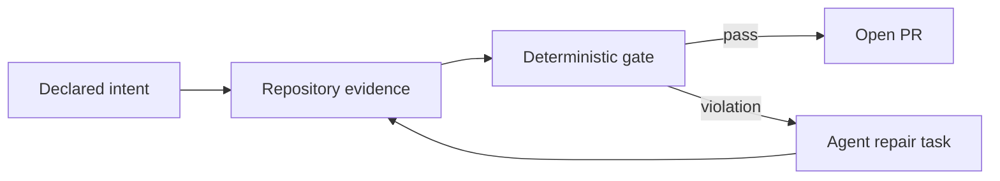

An AI coding agent gets a small feature request. It reads the relevant files, writes the code, adds tests, runs the test suite, and reports success.

Everything is green.

It also made `pricing` import `billing/persistence/postgres` because the function it needed was conveniently sitting there. The feature works. The tests pass. The pull request is small. The architecture is now slightly worse.

This is the old problem of **architecture erosion**, now running at agent speed.

Humans created bad shortcuts long before LLMs arrived. Coding agents did not invent the big ball of mud. They made it possible to add locally reasonable shortcuts in parallel, all day, with clean test output and a cheerful summary.

I built [Archfit](https://github.com/alexei-led/archfit) as an attempt to put architecture governance into the same feedback loop as tests and linters. It is not an AI architect, and it is definitely not proof that a repository has "good architecture." It is a way to define some architectural intent, measure whether the code still follows it, and give both humans and agents a deterministic reason to stop when it does not.

## The Problem Is Governance, Not Code Generation

Architecture governance sounds like something invented to justify a committee. I mean something simpler:

1. **Define intent.** Which modules exist? What do they own? Which APIs are public? Which dependencies and layer directions are allowed?
2. **Observe reality.** What dependencies, cycles, boundary leaks, and cross-module relationships actually exist in the code?
3. **Manage change.** Decide which drift is a defect, which debt is temporarily accepted, and when the intended architecture itself should change.

Without the first step, there is nothing to govern. A diagram in an old presentation is not architecture intent. Neither is the folder structure if nobody can explain whether it is deliberate.

Without the second step, intent becomes documentation that slowly diverges from the repository. The code always wins this argument.

Without the third step, governance becomes a frozen list of rules that prevents useful evolution. Good architecture is not architecture that never changes. It changes deliberately rather than one convenient import at a time.

The number of changed lines is no longer scarce. My ability to understand every structural consequence still is.

## I Tried the Obvious Things

I did not start by deciding that the world needed another CLI.

I wrote project-level [`CLAUDE.md`](https://code.claude.com/docs/en/memory) and [`AGENTS.md`](https://developers.openai.com/codex/agent-configuration/agents-md) files. I described the architecture, important boundaries, coding rules, build commands, and tests. I created focused skills for architecture review. I placed instructions closer to subprojects so an agent would see the relevant rules instead of reading one enormous constitution at the repository root.

This helps. I still do it.

Anthropic's documentation says each Claude Code session starts with a fresh context window and loads `CLAUDE.md` as project context. It also says this explicitly: Claude treats those instructions as **context, not enforced configuration**. OpenAI's `AGENTS.md` mechanism similarly builds a hierarchy of project guidance for Codex.

Instructions can explain why a boundary exists. They cannot guarantee that the current task, current context, and current model will respect it. A Markdown file can ask politely. It cannot fail CI.

Most of my projects also have high test coverage and strict lint rules. That is necessary, but it is not enough.

- Tests answer questions about behavior that somebody thought to assert. They usually do not ask whether `pricing` reached into `billing` internals.
- Coverage says code executed. It does not say the dependency was allowed.
- General linters catch syntax errors, common defects, complexity, and local conventions. They do not know which bounded context owns a discount policy.
- Code review can catch architecture drift, but agent output can now arrive faster than a human can review it deeply.

An agent can therefore produce code that is correct, tested, formatted, secure enough for the current checks, and architecturally wrong. No individual signal is broken. The set of signals is incomplete.

## Archfit in 90 Seconds

Archfit reads architectural intent from `.archfit.yaml`. Here is a small fragment for the opening example:

```yaml
version: 1
languages:
  typescript:
    enabled: true

modules:
  pricing:
    paths: [src/pricing/**]
    public: [src/pricing/api/**]
    subdomain: core
    owner: pricing-team
  billing:
    paths: [src/billing/**]
    public: [src/billing/api/**]
    internal: [src/billing/persistence/**]
    subdomain: supporting
    owner: billing-team

rules:
  - id: contexts_via_contract
    type: public_api_only
    gate: fail
```

This is not a full configuration. It is enough to say that `pricing` and `billing` are separate modules, only named surfaces are public, and `billing/persistence` is internal.

Now the agent adds the import from the opening. Tests still pass. `archfit check` does not.

The gate reports a `public_api_only` violation. Its machine-readable `agent_tasks[]` entry can tell the agent to replace the access from `src/pricing/...` to `src/billing/persistence/...` with the billing public API. It can include the constraints, resolved files when available, and the validation command. The agent changes the dependency and runs the same gate again.

That is the loop:



The important part is not another red message. We have enough red messages. The important part is that the same architectural rule works before the change, during agent repair, and in CI.

Archfit separates three concerns:

1. **Facts:** embedded adapters such as `go/packages`, plus external analyzers such as dependency-cruiser, grimp, ast-grep, SCIP indexers, and clone detection where configured.
2. **Decision:** deterministic rules, metrics, coverage, verdicts, and repair tasks.
3. **Narration:** optional AI summaries and draft semantic labels.

AI does not participate in a gate run. Some commands can draft or directly apply AI-generated configuration, so teams should review that configuration before making it gate input. Once the config and approved labels are fixed, the gate itself is deterministic.

Missing evidence is visible. An optional analyzer that is absent normally produces a coverage gap and an `n/a` metric. Teams can make that absence blocking with analyzer policy or `--require-tools`. Unknown is not silently converted into success.

## What Is Different Here?

I looked for an existing solution before writing Archfit. I found many useful parts.

Project instructions explain intent to agents. Language-specific tools such as ArchUnit, dependency-cruiser, and Import Linter enforce precise rules inside one ecosystem. Architecture-as-code tools such as [FINOS CALM](https://calm.finos.org/) and Structurizr model systems and validate those models. Semantic AI reviews can find misplaced responsibilities and coupling that has no obvious import edge.

These approaches solve different problems. They can also complement one another.

The combination I wanted was narrower:

> Declared repository boundaries, multi-language dependency evidence, baseline-aware deterministic gates, explicit coverage gaps, DDD and Balanced Coupling metadata, and machine-consumable repair tasks in one CI loop.

Archfit does not replace a good language-native checker. It can use those facts. It does not replace architecture models. It checks whether source code follows declared repository intent. It does not replace semantic review. It gives that review repeatable structural evidence.

This last distinction matters. Böckeler's work on maintainability sensors found that raw coupling and dependency data are not enough to decide whether responsibilities are conceptually correct. I agree.

Archfit enforces structural invariants that a team has already decided are important. A deeper semantic review remains a separate, probabilistic layer. Human judgment changes the intent. The deterministic gate keeps that intent from being ignored five pull requests later.

## Faster Generation Needs Faster Feedback

Architecture erosion predates AI. A 2022 [systematic mapping study](https://arxiv.org/abs/2112.10934) reviewed 73 studies and found technical and non-technical causes. Erosion appears as structural violations, lower software quality, and harder evolution. Agents changed the rate, not the problem.

The official [2025 DORA report announcement](https://cloud.google.com/blog/products/ai-machine-learning/announcing-the-2025-dora-report) describes AI as an amplifier. DORA observed a positive relationship between AI adoption and delivery throughput, but a negative relationship with delivery stability. Teams with loosely coupled architectures and fast feedback loops benefited more than teams constrained by tightly coupled systems and slow processes. These are survey relationships, not proof that an LLM caused a particular outage. The direction is still useful: faster change exposes weak control systems.

Birgitta Böckeler's [maintainability sensors for coding agents](https://martinfowler.com/articles/sensors-for-coding-agents.html) explores deterministic dependency rules and other sensors that let agents correct their own work. The important word is *sensor*: a guide tells the agent what we want; a sensor reports what happened.

This continues the [architectural fitness-function](https://www.thoughtworks.com/en-us/insights/books/building-evolutionaryarchitectures-second-edition) idea developed by Neal Ford, Rebecca Parsons, Patrick Kua, and Pramod Sadalage. Important architectural properties should be checked continuously, not remembered during occasional reviews.

Vlad Khononov makes a related point in his posts about the [golden age of modularity](https://www.linkedin.com/pulse/golden-age-modularity-vlad-khononov-swjbf) and [context engineering for coding agents](https://www.linkedin.com/posts/vladikk_software-architecture-superstream-optimizing-activity-7465382571103903744-pOOe). Good modular design narrows the context required for a task. Counting dependencies tells us how many dependencies exist, but not whether the design is sound. One relationship that leaks the wrong knowledge can be worse than many dependencies through stable contracts.

There is also early academic work. In the April 2026 preprint [*Architecture Without Architects: How AI Coding Agents Shape Software Architecture*](https://arxiv.org/abs/2604.04990v1), Phongsakon Mark Konrad, Tim Lukas Adam, Riccardo Terrenzi, and Serkan Ayvaz identify mechanisms by which agents make implicit architectural choices. Their demonstration shows prompt wording producing different structures for the same task. The authors are clear that the demonstration is illustrative and several proposed patterns still need empirical validation. It is a useful framing, not a settled law of software engineering.

The common thread is not "AI writes bad code." Coding agents make design decisions inside local task contexts. Architecture is a system-level property maintained over time.

## Modularity Is Context Engineering for Code

A well-designed module hides decisions that another module does not need to know.

That helps humans. It also helps agents. If `pricing` has a coherent model and a small public contract, an agent changing a pricing rule needs less repository context. If every module shares database tables, framework types, and one universal `Customer` object, the agent must understand half the system before making a safe change. It usually will not, and to be fair, neither will I on Friday afternoon.

This is where strategic Domain-Driven Design matters:

- identify the core, supporting, and generic subdomains;
- define where one model and language are consistent;
- stop that model at a bounded-context boundary;
- integrate contexts through explicit contracts.

DDD here does not mean surrounding CRUD with fourteen factories. It means that two types named `Product` do not automatically represent the same concept, and that business ownership should shape code boundaries.

Microservices do not create those boundaries automatically. A distributed big ball of mud is still mud, only with TLS and a larger cloud bill.

## Coupling Is Not the Enemy

A lot of architecture advice can be reduced to "decouple everything." That produces systems where two related lines of code communicate through three interfaces and an event bus.

Archfit is based on Vlad Khononov's [Balanced Coupling](https://coupling.dev/) model and [*Balancing Coupling in Software Design*](https://www.informit.com/store/balancing-coupling-in-software-design-universal-design-9780137353484). The model asks three questions about a relationship:

1. **Integration strength:** how much knowledge crosses the boundary?
2. **Distance:** how expensive is it to change both sides?
3. **Volatility:** how likely is the upstream component to change?

Strong coupling at low distance can be healthy cohesion. Weak coupling at high distance can be a good contract. The expensive case is strong coupling across distant, independently changing components—especially in a volatile core domain.

Archfit uses the model's per-edge balance formula, `max(|strength - distance|, 10 - volatility) + 1`. Higher means better balanced; low-scoring edges deserve attention first. The result is an estimate based on declared and observed evidence, not an objective architecture grade. The useful part is the explanation of what crosses the boundary and why that relationship is risky.

## Dogfooding, Not a Victory Lap

Archfit dogfoods its own repository and wires the gate into CI. The first
self-configuration used 45 mostly package-shaped modules and reported
**71/100, serviceable**, across 441 scored internal edges.

Then I reviewed the model instead of celebrating the number. I replaced package
boundaries and catch-all stanzas with 17 capability and domain modules. I also
stopped calling Archfit's core policy and evaluation model
"generic, low-volatility" merely because stable labels produce nicer arithmetic.

The corrected score was **40/100, poor**, with high confidence across 400
scored internal edges, no abstained edges, and seven blocking boundary
violations. The code did not suddenly get worse. The architecture model got
more honest.

I then refactored Archfit itself and shipped the result as
[v1.7.1](https://github.com/alexei-led/archfit/releases/tag/v1.7.1). The refactor
groups 102 Go packages into 17 capability-oriented modules without pretending
that a capability is one package. It adds a data-only report contract, keeps the
pipeline engine on stage views instead of the full configuration model, makes
baseline persistence depend on the report contract, and computes the scorecard
once in the CLI composition root before rendering it.

The second dogfood run reports **0 blocking findings**, **68 advisory
warnings**, **400 scored edges**, and the same **40/100** coupling score. The
score did not rise because the remaining high-strength coupling inside the
evaluation core is still real. The important change is that boundary violations
are gone, the output seam is explicit, and the remaining risks are visible
instead of hidden by package-shaped modules or a stale baseline.

Dogfooding also found a limitation in Archfit itself: a module currently has one `layer`. A business capability that spans model, core, and adapter packages must be split into technical-layer modules to enforce dependency direction. Domain boundaries and technical layers are related, but they are not the same thing. Archfit should model them separately.

If the only acceptable dogfood result were perfect, the easiest solution would still be a very understanding configuration.

[Agentbundler](https://github.com/alexei-led/agentbundler/blob/master/docs/architecture.md) is another early deployment. Its CI installs pinned analyzers and runs Archfit in strict-tool mode alongside Go tests, race detection, vet, security checks, and other linters.

These are dogfooding examples, not controlled proof that Archfit will save every architecture. I do not yet have a dramatic case study where one gate prevented a million-dollar rewrite. I have a tool that catches declared structural drift in repositories I work on, and I want more evidence from less friendly codebases.

## What Archfit Cannot Govern

Archfit can check declared module boundaries, public APIs, forbidden dependencies, layer direction, cycles, metric regressions, and configured Balanced Coupling policy. It can produce text, JSON, Markdown, scorecard, and SARIF output.

It cannot understand your whole architecture.

- **The configuration can lie.** Incorrect module paths, owners, subdomains, or public surfaces produce incorrect conclusions, only more consistently.
- **Static analysis has a ceiling.** Runtime and lifecycle coupling, dynamic behavior, and duplicated business rules can be hard to see.
- **Language coverage differs.** Go, TypeScript/JavaScript, Python, and Rust do not expose identical facts or precision.
- **A coupling score is not a quality certificate.** It says nothing by itself about security, performance, data correctness, or whether the business model makes sense.
- **Rules can create noise.** Gate architectural invariants. Review advisories. Do not force an agent to build an abstraction pyramid because one metric looked lonely.
- **Human judgment remains part of governance.** A tool can detect drift from declared intent. Humans must decide when the intent should change.

These are not temporary disclaimers until enough AI is added. They are boundaries of the problem.

## Who Is This For?

Archfit is most useful when a repository has deliberate module boundaries, frequent agent-generated changes, and architectural rules important enough to block a pull request. Multiple languages or analyzers make the common evidence layer more valuable, but they are not required.

A small application with no deliberate boundaries probably needs good tests and one language-native dependency rule before it needs Archfit. Architecture governance cannot enforce intent that nobody has defined. Adding YAML does not count as defining it.

## Try It Without Trusting It

On macOS, Homebrew installs the released binary without requiring a Go SDK.
These commands match Archfit v1.7.1:

```bash
brew install alexei-led/tap/archfit
archfit doctor
archfit config init --root .
archfit analyze -c .archfit.yaml
```

Review the generated modules and policy. Discovery can find structure; it cannot infer your business strategy or team ownership reliably. After review, create and commit a baseline, then put `archfit check -c .archfit.yaml` in CI and the agent repair loop. If you parse JSON, preserve Archfit's process status; the [CI guide](https://github.com/alexei-led/archfit/blob/main/docs/guide/ci.md) shows safe patterns.

The project is open source under Apache-2.0 at [github.com/alexei-led/archfit](https://github.com/alexei-led/archfit).

I want concrete disagreement and ugly repositories:

- configurations that fail to represent real systems;
- false positives and, more importantly, false confidence;
- better evidence for integration strength, distance, and volatility;
- runtime or organizational signals that static code misses;
- agent feedback that is actionable without causing refactoring hysteria;
- language adapters and integrations with existing architecture tools.

If another tool solves part of this better, point me to it. If the Balanced Coupling mapping is wrong, bring an example. If architecture governance cannot be reduced to useful deterministic checks, I want to know exactly where it breaks.

Coding agents will keep generating more changes than humans can inspect line by line. The answer is not a larger prompt asking them to "please respect the architecture." The answer is to make the important intent explicit, make violations observable, and make architectural change deliberate.

The tests should stay green. The architecture should get a check of its own.

---

## Further Reading

- Vlad Khononov, [*Balancing Coupling in Software Design*](https://www.informit.com/store/balancing-coupling-in-software-design-universal-design-9780137353484)
- Vlad Khononov, [*Learning Domain-Driven Design*](https://www.oreilly.com/library/view/learning-domain-driven-design/9781098100124/)
- Neal Ford, Rebecca Parsons, Patrick Kua, and Pramod Sadalage, [*Building Evolutionary Architectures*](https://www.thoughtworks.com/en-us/insights/books/building-evolutionaryarchitectures-second-edition)
- Birgitta Böckeler, [Maintainability sensors for coding agents](https://martinfowler.com/articles/sensors-for-coding-agents.html)
- DORA, [2025 State of AI-Assisted Software Development announcement](https://cloud.google.com/blog/products/ai-machine-learning/announcing-the-2025-dora-report)
- Ruiyin Li, Peng Liang, Mohamed Soliman, and Paris Avgeriou, [*Understanding Software Architecture Erosion*](https://arxiv.org/abs/2112.10934)
