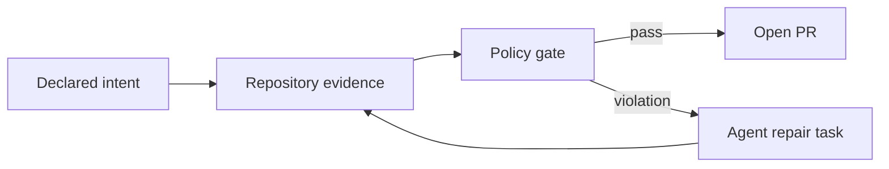

An AI coding agent gets a small feature request. It reads the relevant files, writes the code, adds tests, runs the test suite, and reports success.

Everything is green.

It also made `pricing` import `billing/persistence/postgres` because the function it needed was conveniently sitting there. The feature works. The tests pass. The pull request is small. The architecture is now slightly worse.

This is the old problem of **architecture erosion**, now running at agent speed.

Humans created bad shortcuts long before LLMs arrived. Coding agents did not invent the big ball of mud. They made it possible to add locally reasonable shortcuts in parallel, all day, with clean test output and a cheerful summary.

I built [Archfit](https://github.com/alexei-led/archfit) as an attempt to put architecture governance into the same feedback loop as tests and linters. It is not an AI architect, and it is definitely not proof that a repository has "good architecture." It is a way to define some architectural intent, measure whether the code still follows it, and give both humans and agents a machine-checkable reason to stop when it does not.

## The Problem Is Governance, Not Code Generation

Architecture governance sounds like something invented to justify a committee. I mean something simpler:

1. **Define intent.** Which modules exist? What do they own? Which APIs are public? Which dependencies and layer directions are allowed?
2. **Observe reality.** What dependencies, cycles, boundary leaks, and cross-module relationships actually exist in the code?
3. **Manage change.** Decide which drift is a defect, which debt is temporarily accepted, and when the intended architecture itself should change.

Without the first step, there is nothing to govern. A diagram in an old presentation is not architecture intent. Neither is the folder structure if nobody can explain whether it is deliberate.

Without the second step, intent becomes documentation that slowly diverges from the repository. The code always wins this argument.

Without the third step, governance becomes a frozen list of rules that prevents useful evolution. Good architecture is not architecture that never changes. It changes deliberately rather than one convenient import at a time.

The number of changed lines is no longer scarce. My ability to understand every structural consequence still is.

## I Tried the Obvious Things

I did not start by deciding that the world needed another CLI.

I wrote project-level [`CLAUDE.md`](https://code.claude.com/docs/en/memory) and [`AGENTS.md`](https://learn.chatgpt.com/docs/agent-configuration/agents-md) files. I described the architecture, important boundaries, coding rules, build commands, and tests. I created focused skills for architecture review. I placed instructions closer to subprojects so an agent would see the relevant rules instead of reading one enormous constitution at the repository root.

This helps. I still do it.

Anthropic's documentation says each Claude Code session starts with a fresh context window and loads `CLAUDE.md` as project context. OpenAI's `AGENTS.md` mechanism similarly builds a hierarchy of project guidance for Codex. Both improve context, but they remain guidance to a probabilistic agent.

Instructions can explain why a boundary exists. They cannot guarantee that the current task, context, and model will respect it. A Markdown file can ask politely. It cannot fail CI.

Tests and linters leave a structural gap:

- Tests answer questions about behavior that somebody thought to assert. They usually do not ask whether `pricing` reached into `billing` internals.
- Coverage says code executed. It does not say the dependency was allowed.
- General linters catch syntax errors, common defects, complexity, and local conventions. They do not know which bounded context owns a discount policy.
- Code review can catch architecture drift, but agent output can now arrive faster than a human can review it deeply.

An agent can produce code that behaves as tested, is formatted, and passes every configured check, yet still violates an architectural boundary. No signal is broken. The signal set is incomplete.

## Archfit in 90 Seconds

Archfit reads declared intent from `.archfit.yaml`. This fragment models the opening example:

```yaml
version: 1
languages:
  typescript:
    enabled: true

modules:
  pricing:
    paths: [src/pricing/**]
    public: [src/pricing/api/**]
    subdomain: core
    owner: pricing-team
  billing:
    paths: [src/billing/**]
    public: [src/billing/api/**]
    internal: [src/billing/persistence/**]
    subdomain: supporting
    owner: billing-team

rules:
  - id: contexts_via_contract
    type: public_api_only
    gate: fail
```

This is illustrative, not a complete project configuration. The module paths assign files to `pricing` and `billing`; `public` names the intended contract, while `internal` marks billing's persistence code. Assuming TypeScript dependency evidence is available, `public_api_only` rejects cross-module access from pricing into that internal path. Billing may still use its own internals. The rule does not decide whether the public API itself is well designed.

When the agent adds the opening import, tests pass but `archfit check` reports the violation. Its machine-readable repair task can identify the source and target, state the constraint, include resolved files when available, and give the validation command. The agent repairs the dependency and reruns the gate.



The same rule now runs during local repair and in CI. Language adapters collect facts; an LLM-free decision layer checks them against fixed configuration. Given the same configuration and analyzer evidence, it returns the same verdict. Optional AI summaries and configuration drafting stay outside the gate. That repeatability covers the decision layer, not the whole toolchain: reproducible CI also requires pinned analyzer versions.

While improving Pumba's internal modularity, a real run made this distinction concrete. [Pumba](https://github.com/alexei-led/pumba) is a Go chaos-engineering tool with a deliberate `.archfit.yaml`; four fail gates passed with full applicable-file coverage and no import cycles. The same run raised 12 Balanced Coupling advisories, including `cmd/commands.go` → `pkg/chaos`: score 2, model coupling into a high-volatility module. Because `cmd` is the composition root, that edge may be intentional. Gates block declared violations; advisories start a review.

Missing evidence remains visible. An absent optional analyzer produces a coverage gap and leaves affected metrics `n/a`; teams can make that absence blocking. Unknown is not silently converted into success.

## What Is Different Here?

I looked for an existing solution before writing Archfit. I found many useful parts.

Project instructions explain intent to agents. Language-specific tools such as ArchUnit, dependency-cruiser, and Import Linter enforce precise rules inside one ecosystem. Architecture-as-code tools such as [FINOS CALM](https://calm.finos.org/) and Structurizr model systems and validate those models. Semantic AI reviews can find misplaced responsibilities and coupling that has no obvious import edge.

These approaches solve different problems. They can also complement one another.

The combination I wanted was narrower: one CI loop joining declared repository boundaries, multi-language dependency evidence, baseline-aware gates, explicit coverage gaps, and machine-readable repair tasks. DDD and Balanced Coupling metadata add meaning to those structural facts.

Archfit can consume facts from language-native tools and compare source dependencies with declared repository intent. Architecture models and semantic reviews remain separate: the former describe the system; the latter can judge responsibilities that no import graph can see.

This distinction matters. Böckeler's maintainability-sensor experiment reaches the same limit: raw coupling and dependency data are not enough to decide whether responsibilities are conceptually correct.

Archfit enforces structural invariants that a team has already chosen. Human judgment changes the intent; the LLM-free decision layer keeps that intent from being ignored five pull requests later.

## Faster Generation Needs Faster Feedback

Architecture erosion predates AI. A 2022 [systematic mapping study](https://arxiv.org/abs/2112.10934) reviewed 73 studies and found technical and non-technical causes. Erosion appears as structural violations, lower software quality, and harder evolution. Agents changed the rate, not the problem.

The official [2025 DORA report announcement](https://cloud.google.com/blog/products/ai-machine-learning/announcing-the-2025-dora-report) describes AI as an amplifier. DORA observed a positive relationship between AI adoption and delivery throughput, but a negative relationship with delivery stability. Teams with loosely coupled architectures and fast feedback loops benefited more than teams constrained by tightly coupled systems and slow processes. These are survey relationships, not proof that an LLM caused a particular outage. The direction is still useful: faster change exposes weak control systems.

Birgitta Böckeler's [maintainability sensors for coding agents](https://martinfowler.com/articles/sensors-for-coding-agents.html) explores deterministic dependency rules and other sensors that let agents correct their own work. The important word is *sensor*: a guide tells the agent what we want; a sensor reports what happened.

This continues the [architectural fitness-function](https://www.thoughtworks.com/en-us/insights/books/building-evolutionaryarchitectures-second-edition) idea developed by Neal Ford, Rebecca Parsons, Patrick Kua, and Pramod Sadalage. Important architectural properties should be checked continuously, not remembered during occasional reviews.

Vlad Khononov makes a related point in his posts about the [golden age of modularity](https://www.linkedin.com/pulse/golden-age-modularity-vlad-khononov-swjbf) and [context engineering for coding agents](https://www.linkedin.com/posts/vladikk_software-architecture-superstream-optimizing-activity-7465382571103903744-pOOe). Good modular design narrows the context required for a task. Counting dependencies tells us how many dependencies exist, but not whether the design is sound. One relationship that leaks the wrong knowledge can be worse than many dependencies through stable contracts.

There is also early academic work. In the April 2026 preprint [*Architecture Without Architects: How AI Coding Agents Shape Software Architecture*](https://arxiv.org/abs/2604.04990v1), Phongsakon Mark Konrad, Tim Lukas Adam, Riccardo Terrenzi, and Serkan Ayvaz identify mechanisms by which agents make implicit architectural choices. Their demonstration shows prompt wording producing different structures for the same task. The authors are clear that the demonstration is illustrative and several proposed patterns still need empirical validation. It is a useful framing, not a settled law of software engineering.

The common thread is not "AI writes bad code." Coding agents make design decisions inside local task contexts. Architecture is a system-level property maintained over time.

## Modularity Is Context Engineering for Code

A well-designed module hides decisions that another module does not need to know.

That helps humans. It also helps agents. If `pricing` has a coherent model and a small public contract, an agent changing a pricing rule needs less repository context. If every module shares database tables, framework types, and one universal `Customer` object, the agent must understand half the system before making a safe change. It usually will not, and to be fair, neither will I on Friday afternoon.

This is where strategic Domain-Driven Design matters:

- identify the core, supporting, and generic subdomains;
- define where one model and language are consistent;
- stop that model at a bounded-context boundary;
- integrate contexts through explicit contracts.

DDD here does not mean surrounding CRUD with fourteen factories. It means that two types named `Product` do not automatically represent the same concept, and that business ownership should shape code boundaries.

Microservices do not create those boundaries automatically. A distributed big ball of mud is still mud, only with TLS and a larger cloud bill.

## Coupling Is Not the Enemy

A lot of architecture advice can be reduced to "decouple everything." That produces systems where two related lines of code communicate through three interfaces and an event bus.

Archfit is based on Vlad Khononov's [Balanced Coupling](https://coupling.dev/) model and [*Balancing Coupling in Software Design*](https://www.informit.com/store/balancing-coupling-in-software-design-universal-design-9780137353484). The model asks three questions about a relationship:

1. **Integration strength:** how much knowledge crosses the boundary?
2. **Distance:** how expensive is it to change both sides?
3. **Volatility:** how likely is the upstream component to change?

Strong coupling at low distance can be healthy cohesion. Weak coupling at high distance can be a good contract. The expensive case is strong coupling across distant, independently changing components—especially in a volatile core domain.

Khononov's Chapter 10 formula treats the dimensions as ordinal categories, not physical measurements. Contract and intrusive coupling anchor strength at 1 and 10; distance runs from 2 for the same module to 9 for separate deploy units; volatility uses published anchors of 1, 3, and 10. Archfit maps repository evidence onto those categories and adds a documented midpoint of 6 for `medium` volatility.

For each edge it applies `max(|strength - distance|, 10 - volatility) + 1`, producing a balance from 1 (critical) to 10 (well balanced). Strong coupling can be healthy when distance is low; it becomes expensive when distant components must co-evolve, especially when the dependency is volatile. The score is a review heuristic based on declared and observed evidence, not an objective architecture grade. Its value is the explanation of what crosses the boundary and why that relationship may be risky.

## What Archfit Cannot Govern

Archfit can check declared module boundaries, public APIs, forbidden dependencies, layer direction, cycles, metric regressions, and configured Balanced Coupling policy.

It cannot understand your whole architecture.

- **The configuration can lie.** Incorrect module paths, owners, subdomains, or public surfaces produce incorrect conclusions, only more consistently.
- **The gate does not protect its own policy.** Require review for `.archfit.yaml` and baseline changes. An agent allowed to weaken them merely to make its own change pass can bypass the control.
- **Static analysis has a ceiling.** Runtime and lifecycle coupling, dynamic behavior, and duplicated business rules can be hard to see.
- **Language coverage differs.** Go, TypeScript/JavaScript, Python, and Rust do not expose identical facts or precision.
- **A coupling score is not a quality certificate.** It says nothing by itself about security, performance, data correctness, or whether the business model makes sense.
- **Rules can create noise.** Gate architectural invariants. Review advisories. Do not force an agent to build an abstraction pyramid because one metric looked lonely.
- **Human judgment remains part of governance.** A tool can detect drift from declared intent. Humans must decide when the intent should change.

These are not temporary disclaimers until enough AI is added. They are boundaries of the problem.

## Who Is This For?

Archfit is most useful when a repository has deliberate module boundaries, frequent agent-generated changes, and architectural rules important enough to block a pull request. Multiple languages or analyzers make the common evidence layer more valuable, but they are not required.

A small application with no deliberate boundaries probably needs good tests and one language-native dependency rule before it needs Archfit. Architecture governance cannot enforce intent that nobody has defined. Adding YAML does not count as defining it.

## Try It Without Trusting It

Archfit is open source under Apache-2.0 at [github.com/alexei-led/archfit](https://github.com/alexei-led/archfit). The project [quick start](https://github.com/alexei-led/archfit/blob/main/docs/guide/quick-start.md) covers installation and initial configuration; the [CI guide](https://github.com/alexei-led/archfit/blob/main/docs/guide/ci.md) covers baselines, exit codes, and safe JSON handling.

The short version is: generate a draft configuration, review the discovered modules and policy, establish a baseline, and run the gate in CI. Discovery can find structure; it cannot infer business strategy or team ownership reliably.

I want counterexamples: systems the configuration cannot represent, false confidence, better evidence for strength, distance, and volatility, and runtime or organizational signals that static code misses. If another tool handles part of this better, or the Balanced Coupling mapping breaks on a real repository, bring the example.

Coding agents can produce more changes than humans can inspect line by line. Make important intent explicit, violations observable, and architectural change deliberate.

The tests should stay green. The architecture should get a check of its own.

---

## Further Reading

- Vlad Khononov, [*Balancing Coupling in Software Design*](https://www.informit.com/store/balancing-coupling-in-software-design-universal-design-9780137353484)
- Vlad Khononov, [*Learning Domain-Driven Design*](https://www.oreilly.com/library/view/learning-domain-driven-design/9781098100124/)
- Neal Ford, Rebecca Parsons, Patrick Kua, and Pramod Sadalage, [*Building Evolutionary Architectures*](https://www.thoughtworks.com/en-us/insights/books/building-evolutionaryarchitectures-second-edition)
- Birgitta Böckeler, [Maintainability sensors for coding agents](https://martinfowler.com/articles/sensors-for-coding-agents.html)
- DORA, [2025 State of AI-Assisted Software Development announcement](https://cloud.google.com/blog/products/ai-machine-learning/announcing-the-2025-dora-report)
- Ruiyin Li, Peng Liang, Mohamed Soliman, and Paris Avgeriou, [*Understanding Software Architecture Erosion*](https://arxiv.org/abs/2112.10934)
